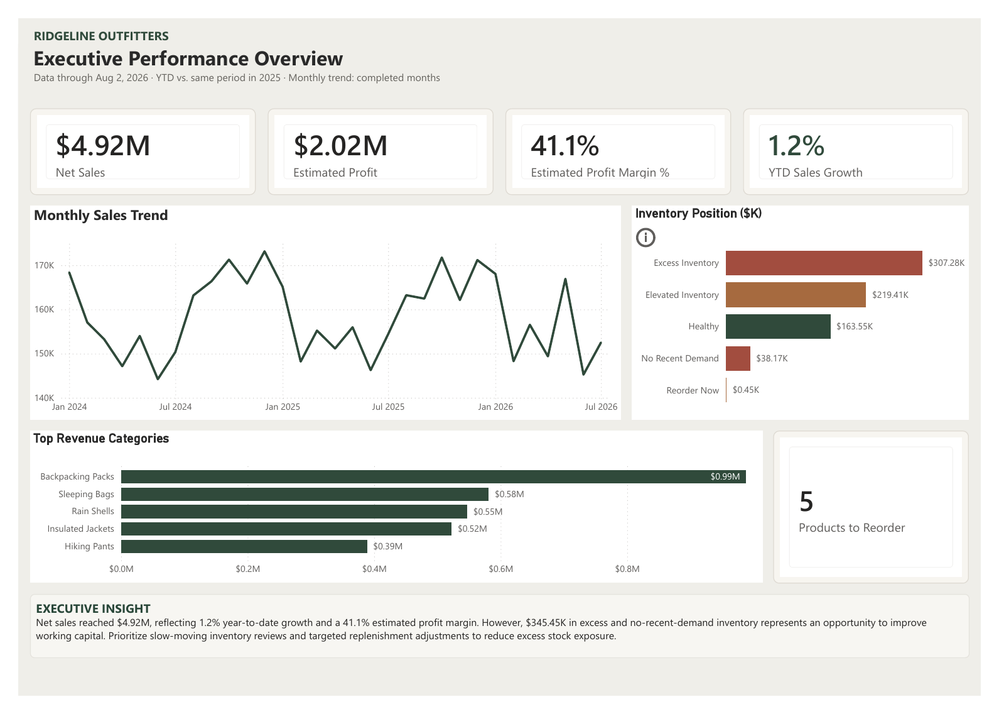
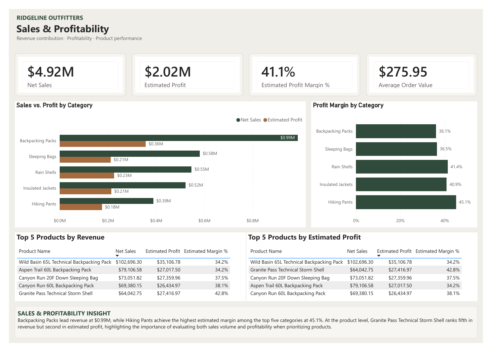
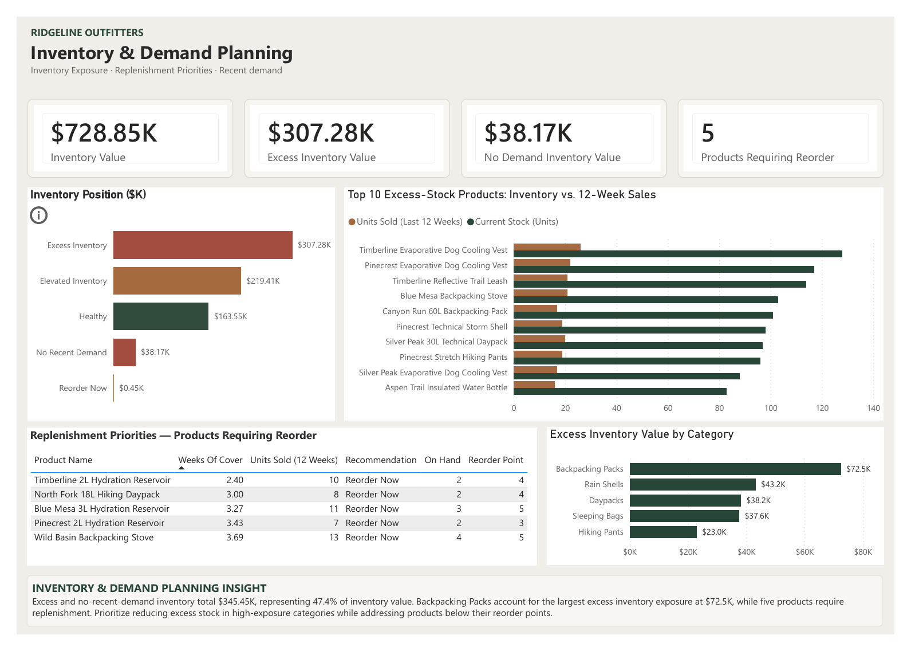
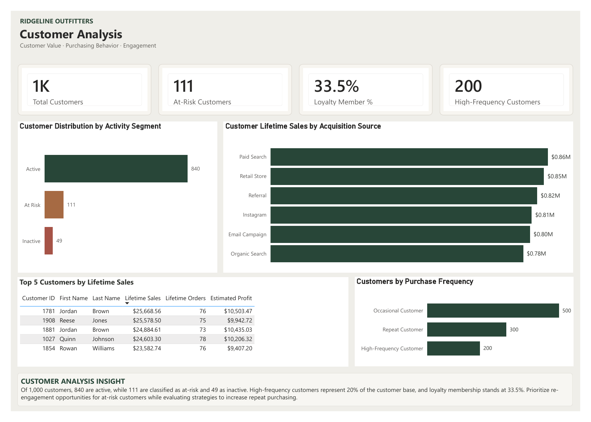

# RidgeLine Outfitters | Retail Analytics Portfolio

**Databricks SQL · Medallion Architecture · Power BI · Sales, Inventory & Customer Analytics**

## Project overview

RidgeLine Outfitters is a portfolio retail analytics case study connecting sales performance, inventory demand planning, and customer behavior. The project uses Databricks to organize data into Bronze, Silver, and Gold layers and Power BI to communicate operational decisions through four report pages.

> **Portfolio status:** SQL has been extracted and organized from an exported Databricks workspace. On November 8, 2026, read-only checks of the live Gold tables matched the report headline totals for sales, inventory and customers. The Power BI `.pbix`, four dashboard preview images, and PDF export are included. These SQL scripts are **reference/review copies**, not a fully reproducible deployment pipeline.

## Dashboard preview

The report contains four pages. Click any image to see it at full size.

| Executive Performance Overview | Sales & Profitability |
|---|---|
|  |  |
| Inventory & Demand Planning | Customer Analysis |
|  |  |

[View the four-page PDF report](dashboard/RidgeLine_Analytics_Dashboard.pdf) · [Power BI Desktop file](powerbi/RidgeLine_Analytics_Dashboard.pbix)

## Business questions

- How are sales, estimated profit, and growth trending?
- Which categories and products generate revenue versus estimated profit?
- Where is working capital tied up in excess or no-demand inventory?
- Which products fall below replenishment thresholds?
- Which customers are active, at risk, or inactive, and how do acquisition and purchase frequency relate to lifetime sales?

## Architecture

```text
Bronze (raw/source tables and historical generation)
    customers · products · warehouses · inventory · orders
                         ↓
Silver (standardized operational entities)
    customers · products · warehouses · inventory · orders
                         ↓
Gold (business-ready analytic tables)
    gold_sales_performance
    gold_inventory_demand_planning
    gold_customer_analysis
                         ↓
Power BI (four-page interactive report)
```

See [Architecture and lineage](docs/ARCHITECTURE.md) for table dependencies and modeling limitations.

## Report pages

| Page | Focus | Key measures / visuals |
|---|---|---|
| 1. Executive Performance Overview | Company-wide performance | Net sales, estimated profit, margin, aligned YTD growth, inventory position |
| 2. Sales & Profitability | Category and product profitability | Revenue/profit by category, margins, top-five product rankings |
| 3. Inventory & Demand Planning | Excess inventory and replenishment | Inventory position, excess-stock products, reorder priorities, excess by category |
| 4. Customer Analysis | Customer health and value | Activity segments, acquisition source, lifetime sales leaders, purchase frequency |

## Business findings

The headline sales, inventory and customer totals below were reconciled to live Gold-table validation results on November 8, 2026; detailed category and segment figures are from the reviewed Power BI report. See [Findings](docs/BUSINESS_FINDINGS.md) and [Practical recommendations](docs/BUSINESS_RECOMMENDATIONS.md) for interpretation, next actions, measurement and caveats.

| Measure | Reported value |
|---|---:|
| Completed sales records | 17,826 |
| Net sales | $4,919,152.80 |
| Estimated profit | $2,021,282.81 |
| Estimated profit margin | 41.1% |
| Total inventory value | $728,853.20 |
| Excess inventory | $307,275.31 |
| No-recent-demand inventory | $38,165.45 |
| Products requiring reorder | 5 |
| Customers | 1,000 |
| Active / at-risk / inactive | 840 / 111 / 49 |

## Repository guide

- `sql/bronze/` — extracted final table-building statements; **not** a full ingestion/reproduction layer
- `sql/silver/` — extracted Silver transformations
- `sql/gold/` — extracted final Gold table-building statements
- `sql/validation/` — **read-only** reconciliation queries
- `docs/ARCHITECTURE.md` — architecture, lineage, assumptions and limitations
- `docs/BUSINESS_FINDINGS.md` — findings, caveats, recommendations
- `docs/SQL_REVIEW.md` — code review and safe execution notes
- `dashboard/` — placeholder for the existing Power BI file and screenshots

## Data and metric definitions

**Estimated profit** is net sales less estimated product cost using product `UnitCost`; it is **not** audited accounting profit and excludes shipping and other operating costs. Inventory uses a **12-week demand window** anchored to the latest completed order date, not the computer's current date. Inventory recommendations are at **product aggregate** level rather than per-warehouse level. Product names and customer names are not unique; visual rankings must use `ProductID` and `CustomerID`, respectively.

## Validation and reproducibility

The extracted SQL preserves the final `CREATE OR REPLACE TABLE` statement from each exported notebook. Historical data-generation and repair steps were **not fully reconstructed**. Running these files blindly could replace tables or reproduce different data. See [SQL review](docs/SQL_REVIEW.md) and [read-only checks](sql/validation/VALIDATION_QUERIES.sql). No live Databricks tables were modified during this review.

## Tools and skills demonstrated

Databricks SQL, layered data transformations, dimensional joins, business metrics, inventory segmentation, customer lifecycle analysis, Power BI/DAX, visual interaction design, data quality review, and decision-oriented storytelling.

## Data model (ERD)

See the [Silver-layer Entity Relationship Diagram](docs/ERD.md) and [PNG diagram](docs/ERD.png) for the five core entities and their logical relationships. The model documents the underlying data architecture; the three Gold tables are analytical outputs built from this model.

## Portfolio series and supporting decisions

This repository is **Portfolio Project 1**. [Project 2 — Demand Forecasting & Operational Optimization](docs/PROJECT_2_ROADMAP.md) is a proposed follow-up, not a completed deliverable.

- [Business recommendations and proposed 30/60/90-day plan](docs/BUSINESS_RECOMMENDATIONS.md)
- [Data quality and validation decisions](docs/DATA_QUALITY_DECISIONS.md)
- [Silver-layer logical ERD](docs/ERD.md) and [diagram image](docs/ERD.png)

## Current handoff

The existing Power BI `.pbix` and four report screenshots have not been provided as files in this package. Place them in `dashboard/` before publishing. The source SQL is a documented portfolio extract, not a turnkey deployment.
