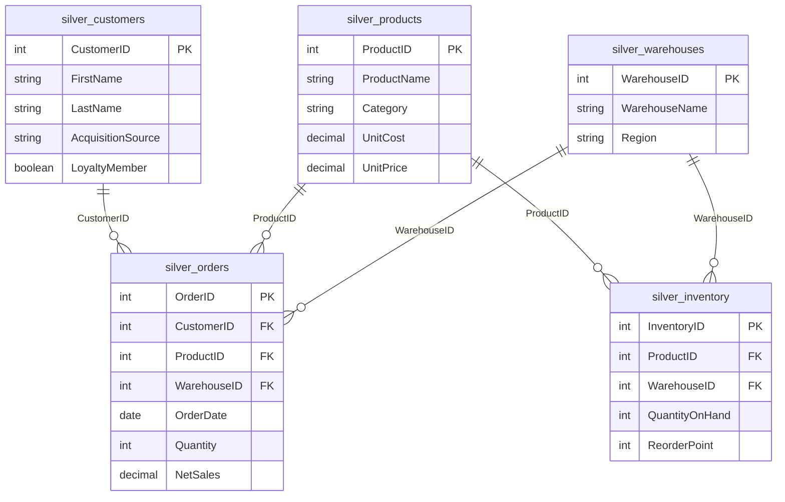
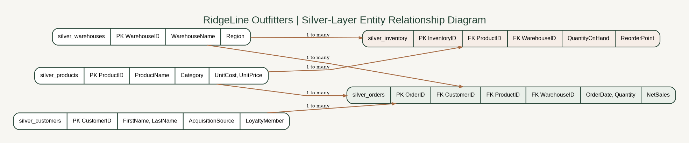

# RidgeLine Outfitters — Entity Relationship Diagram

This diagram describes the **Silver-layer logical data model**, derived from the Databricks notebooks. PK = primary-key candidate; FK = foreign-key reference. The relationships reflect join logic and notebook validation, not a claim that physical foreign-key constraints are enforced in Databricks.

## Gold analytical outputs

- `gold_sales_performance`: completed-order sales and estimated profitability, derived from `silver_orders`, `silver_products`, and `silver_warehouses`.
- `gold_inventory_demand_planning`: product-level inventory and 12-week demand planning, derived from `silver_products`, aggregated `silver_inventory`, and `silver_orders`. It is **not warehouse-grain**.
- `gold_customer_analysis`: customer-level lifetime metrics and segmentation, derived from `silver_customers`, `silver_orders`, and `silver_products`.

**Grain caution:** ProductName and customer full name are not unique identifiers. Use ProductID and CustomerID for distinct entity rankings.

**Validation:** On November 8, 2026, read-only Gold checks returned 17,826 distinct completed orders, 500 distinct products, and 1,000 distinct customers, matching dashboard totals. Those checks do not independently establish every Silver-layer relationship or physical key constraint.
